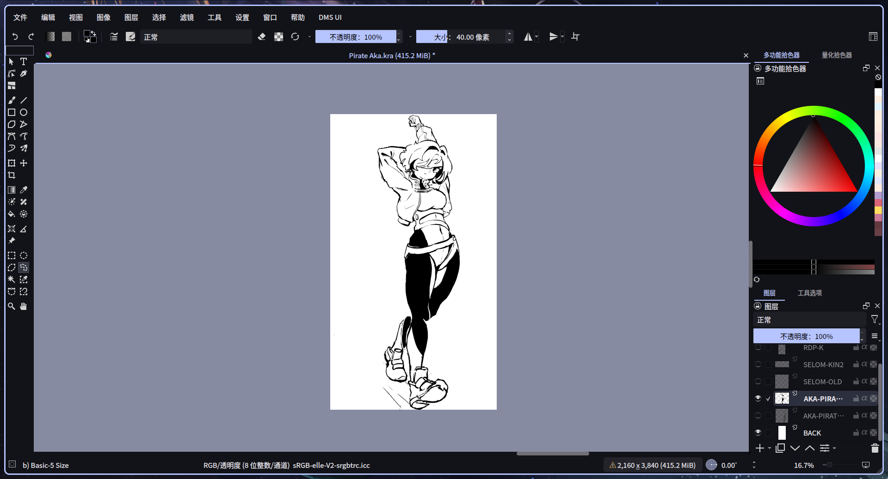
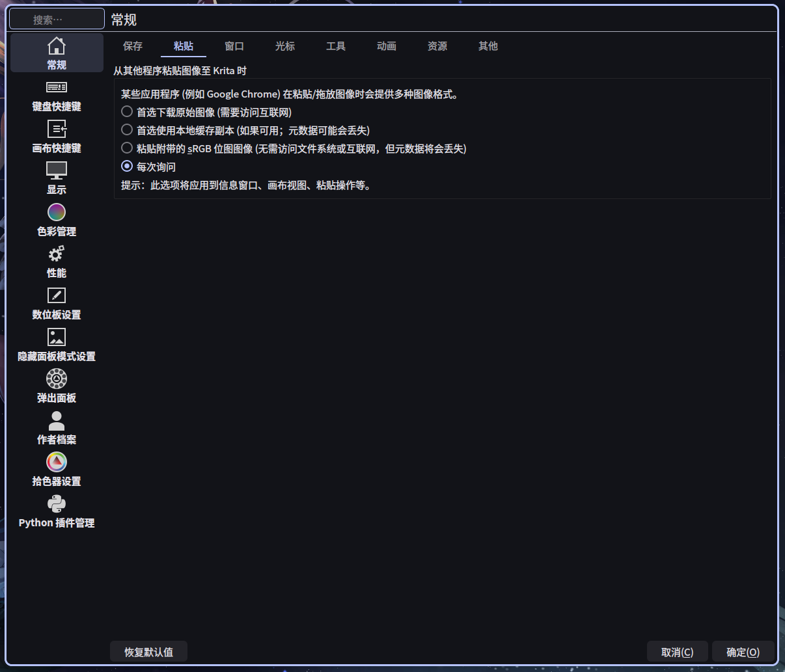

# DMS Modern UI for Krita

用于配合 dank material shell + niri 环境下动态配色的一套 krita UI 插件。

主要作用是修改 krita 的 UI 样式：圆角、现代化、鼠标悬停高亮等。

拥有读取主题色彩的功能，配合 dank shell（mutagen）主题风味最佳。

## 起因

起初在 linux 上使用 krita 作画，发现 UI 在笔记本 + niri + dms 的环境下个人不是很满意。虽然有 Dank Shell 的主题可以让 krita 动态读取电脑壁纸主题色彩，但色彩上统一了，UI 却没有现代化、扁平化。于是基于一种 harmony 的动机，开始对 krita 的 UI 界面进行魔改。

我找到了 Style Sheet Loader、Krita-MorandiUI 和 Krita UI Redesign，却发现都不是特别满意：

- Style Sheet Loader 中可以读取样式，但是在每次启动 krita 都会造成一定延迟，观感不好。
- Krita UI Redesign 似乎无法在 krita 6.x 上运行。
- Krita-MorandiUI 中的配色无法实现 niri + dms 的动态读色。

遂便有了此项目 krita-DMS-UI；我使用了大肥鱼 deepseek 帮我完成这些。

> 本人作画环境：Laptop、CachyOS + niri + dms、Krita 6.x、数位板作画习惯。

当前版本：**1.0**

## 项目关系

```text
Krita UI Redesign（2020，Kapyia & Pedro Reis）
        ↓
Krita-MorandiUI（LanRhyme）
        ↓
Krita-DMS-UI / DMS Modern UI（本项目）
```

本项目很大程度上参照了 [Krita-MorandiUI](https://github.com/LanRhyme/Krita-MorandiUI)；配色另外接的是 DankMaterialShell / matugen 的动态调色板（这是配色来源，不是上游项目）。三个 UI 项目都按 GPL-3.0 分发。

## 示例

主界面：



菜单：



## 功能

- 从 Krita 的 `QPalette` 取色，跟随 matugen / DankMaterialShell，深色浅色都适配。
- 菜单栏、工具栏、菜单、标签页、面板、输入框、滚动条统一圆角。
- M3 状态层，勾选控件用 `QProxyStyle` 自绘。
- 菜单、子菜单、ComboBox、tooltip 淡入淡出，时长跟随 DMS。
- 换壁纸后监听 `.colors` 热重载配色，不用重启 Krita。
- 欢迎页整理，SpinBox 箭头换成 SVG 图标。
- `DMS UI` 菜单：菜单显隐、隐藏快捷键提示、动画开关。

## 安装

把 `krita_dms_ui/` 和 `krita_dms_ui.desktop` 放进 Krita 的 `pykrita/` 目录：

| 平台 | 路径 |
| :--- | :--- |
| Linux | `~/.local/share/krita/pykrita/` |
| Windows | `%APPDATA%\krita\pykrita\` |
| macOS | `~/Library/Application Support/Krita/pykrita/` |

Linux 从源码安装可以直接软链接：

```bash
git clone https://github.com/NoDoFes/Krita-DMS-UI.git
cd Krita-DMS-UI
mkdir -p ~/.local/share/krita/pykrita
ln -sfn "$PWD/krita_dms_ui" ~/.local/share/krita/pykrita/krita_dms_ui
ln -sfn "$PWD/krita_dms_ui.desktop" ~/.local/share/krita/pykrita/krita_dms_ui.desktop
```

然后打开 **设置 → 配置 Krita → Python 插件管理器**，勾选 **DMS Modern UI**，重启 Krita。

## 使用

菜单栏最右侧的 **DMS UI** 里可以：

- 显示 / 隐藏顶部菜单。
- 隐藏菜单栏快捷键提示（个人觉得有些繁杂了，因作画习惯是左手键盘右手数位板）。
- 开关菜单 / 下拉列表动画。

换壁纸后颜色会自动刷新，不需要手动重载。

## 已知问题

- 主要是在 Krita 6.x / Linux 上试的，Krita 5 没充分测试。
- 不要和 Krita-MorandiUI、Style Sheet Loader 等 UI 插件同时开。
- 有些 Krita 自己画的控件改不到，只能单独补（比如调整透明度和笔刷大小的箭头，用的是自己做的 SVG）。
- 热重载后颜色和 QSS 会立刻变，但部分 KDE 图标可能要重启 Krita。
- 菜单淡出是把菜单最后一帧盖在主窗口上做的，超出主窗口的部分会被裁掉。
- 勾选控件是 `QProxyStyle` 自绘的，切 Krita 样式后可能出现问题，还没完全验证。

## 来源与许可

- 本项目：[Krita-DMS-UI](https://github.com/NoDoFes/Krita-DMS-UI)
- 基于：[Krita-MorandiUI](https://github.com/LanRhyme/Krita-MorandiUI)
- MorandiUI 基于 2020 年的 **Krita UI Redesign**
  - 原作者：Kapyia、Pedro Reis
  - Copyright (C) 2020
  - GNU General Public License v3

本项目也按 **GPL-3.0** 分发，见 [LICENSE](LICENSE)。本项目的实现离不开上面的项目作者，对他们实际感谢。
